# SiYuan PDF × Zotero

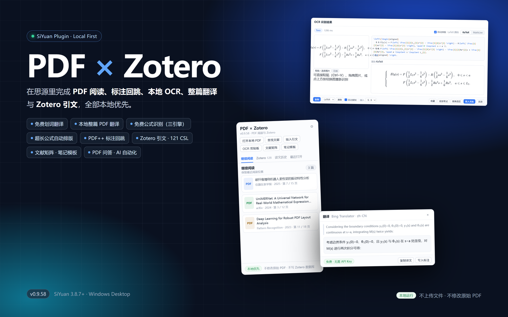

[](https://b3log.org/siyuan/)
[](https://www.typescriptlang.org/)
[](LICENSE)

在思源笔记里完成 **PDF 阅读、PDF++ 风格标注回跳、本地公式 OCR、免费划词翻译、本地整篇 PDF 翻译、Zotero 引文、文献矩阵、默认笔记模板、PDF 问答与 AI 自动化**。

本地优先：不修改原始 PDF、不写 Zotero 数据库、OCR 与翻译服务全部跑在本机。

当前版本：**v0.9.60** · [统一发布页](https://github.com/DJYDN/siyuan-pdf-zotero/releases/tag/v0.9.60)

---

## 亮点

- **本地公式 OCR 三引擎**：Texo（20M 轻量 ONNX，公式最快）/ UniMERNet（公式）/ Pix2Text（公式 + 文本 + 混合），可只装一个或同时装；公式按优先级自动降级，三个引擎包都自带 Python 运行时，解压选目录即用。
- **Texo 风格识别弹窗**：来源图 + LaTeX 源码编辑 + KaTeX/MathLive 渲染同屏；复制/自动复制支持 LaTeX、`$...$`、`$$...$$`、`\(...\)`、`\[...\]`、align、equation、Markdown、Typst、MathML。
- **超长公式自动排版**：OCR 结果自动安全换行 + 缩进 + 压缩 `\,` 噪声，渲染结果不变；已有公式块右键「格式化公式」。
- **翻译全免费起步**：划词翻译内置 Bing / MyMemory 无需 Key；整篇 PDF 可本地跑 PDF2zh（双语对照/纯译文），也可用个人 Doc2X 账号；解析与翻译历史统一在 Dock「解析翻译」中管理。
- **PDF++ 式阅读**：高亮、摘录、区域截图、区域链接、点击笔记回跳原位、悬浮预览 PDF 内链与标注卡片。
- **Zotero 深度集成**：Local API 搜索、Collection 过滤、结构化引文、121 种 CSL 样式、引文编号自动刷新。
- **设置已重构**：5 个一级页 + 全局搜索 + 即时生效；需要重启服务的项通过顶部「立即应用」统一生效。

---

## 界面预览

<details>
<summary><b>Dock 面板与阅读入口</b></summary>

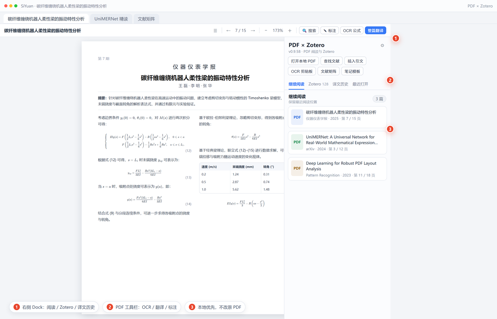

右侧 Dock 统一承载继续阅读、Zotero 文献、译文历史；PDF 工具栏提供 OCR、翻译、标注、问答入口。
</details>

<details>
<summary><b>笔记中的图片 / 高亮文本回跳 PDF</b></summary>

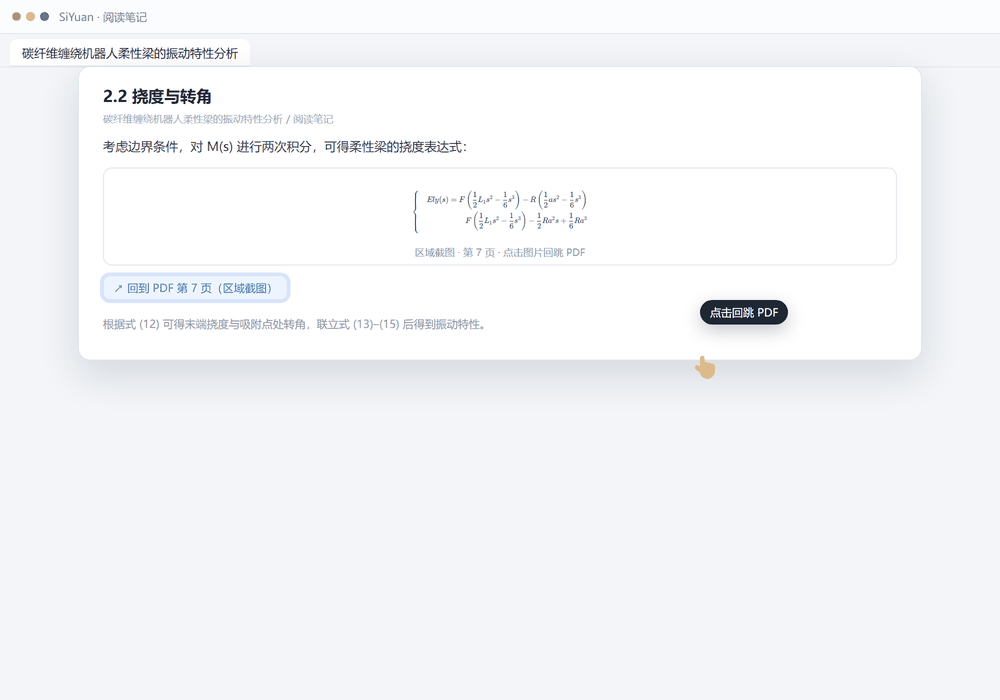

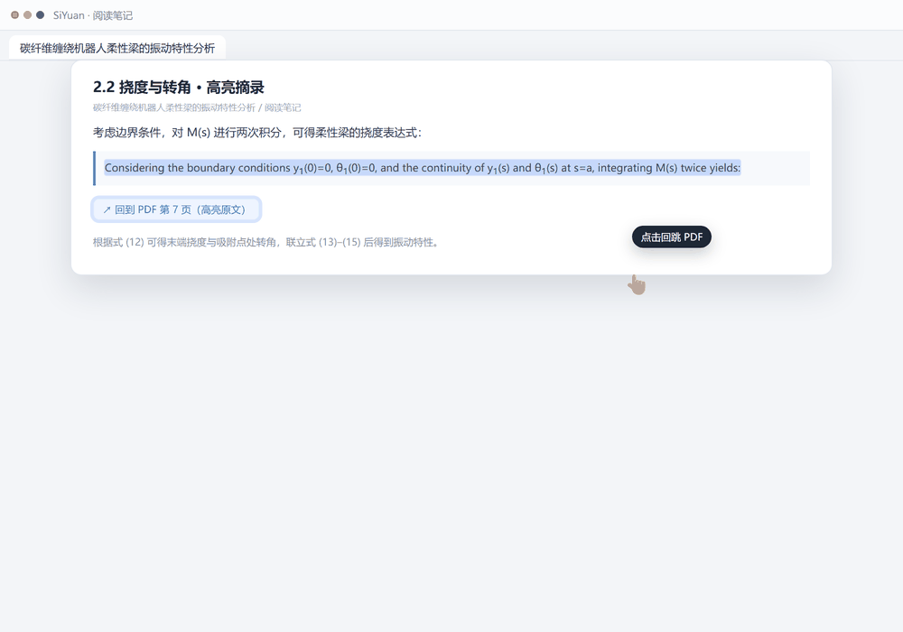

笔记里的区域截图和高亮摘录都带来源链接：点击回到 PDF 对应页面，并把原来的区域/原文高亮出来。
</details>

<details>
<summary><b>免费划词翻译</b></summary>

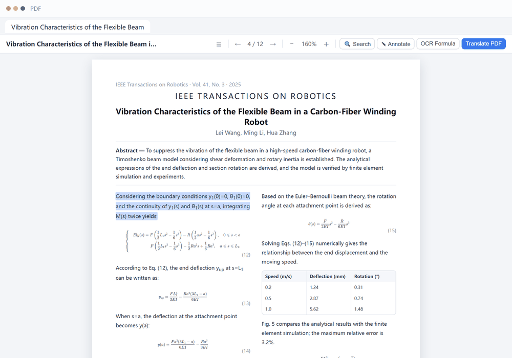

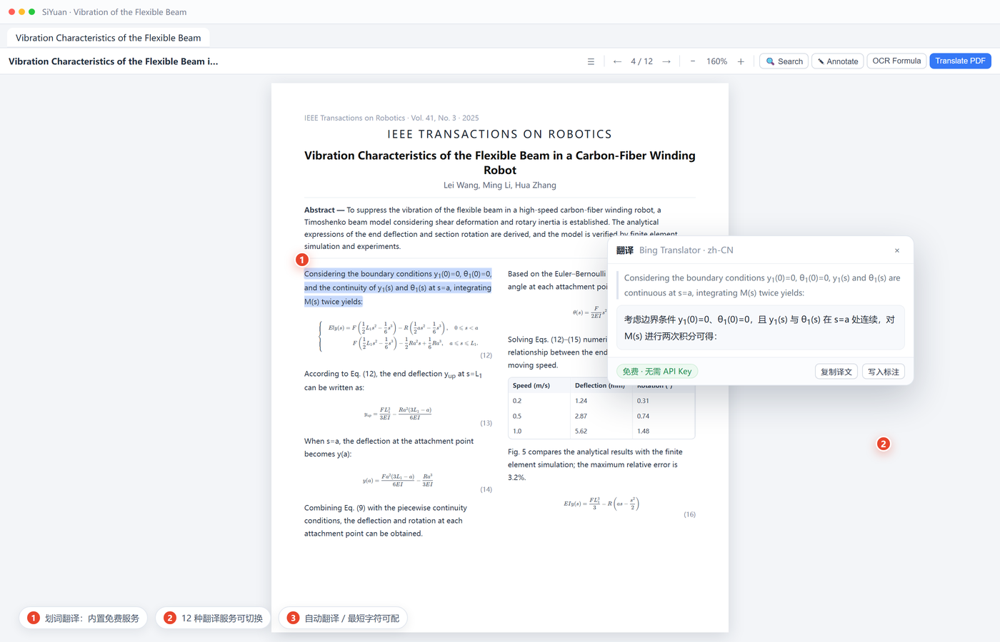

内置 Bing / MyMemory 免费服务，无需 API Key；译文可直接复制或写入标注。
</details>

<details>
<summary><b>本地整篇 PDF 翻译（PDF2zh）</b></summary>

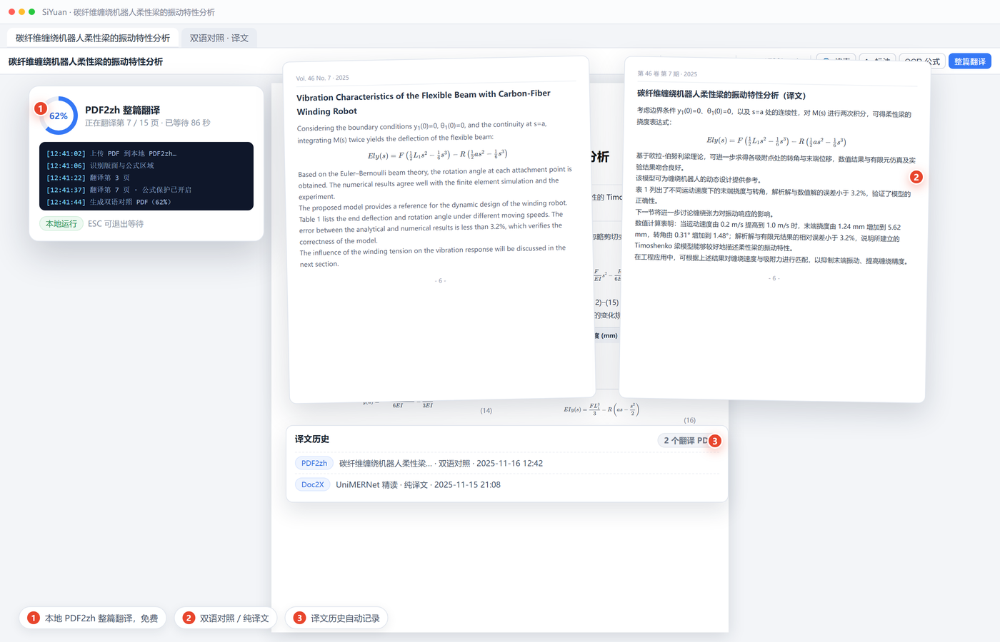

本地 PDF2zh 翻译，进度与日志实时可见（ESC 可退出等待），支持双语对照/纯译文与译文历史。
</details>

<details>
<summary><b>免费公式识别</b></summary>

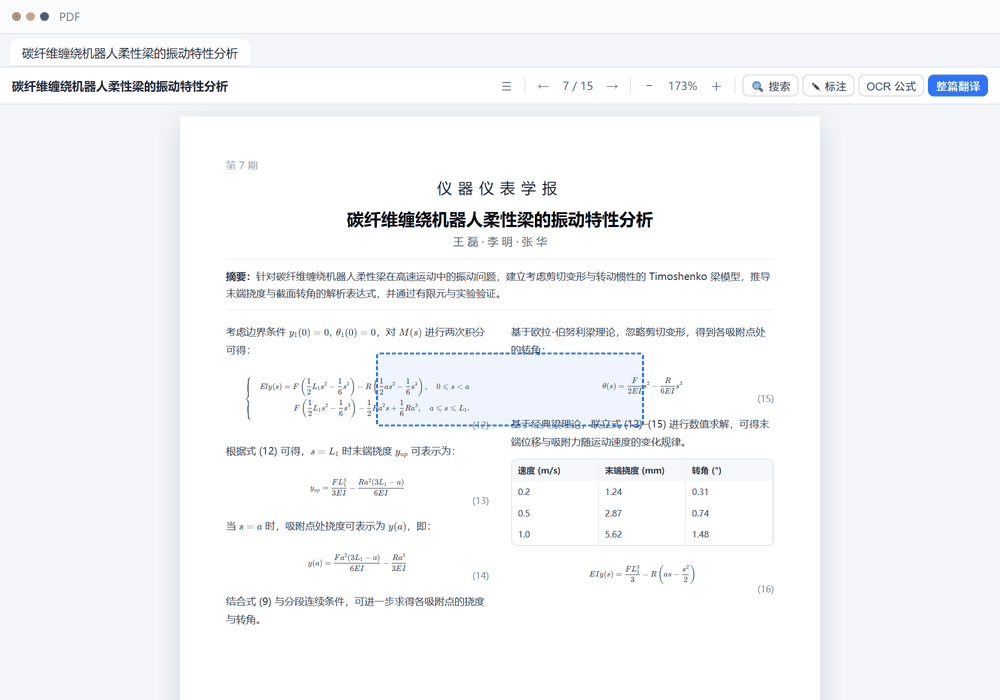

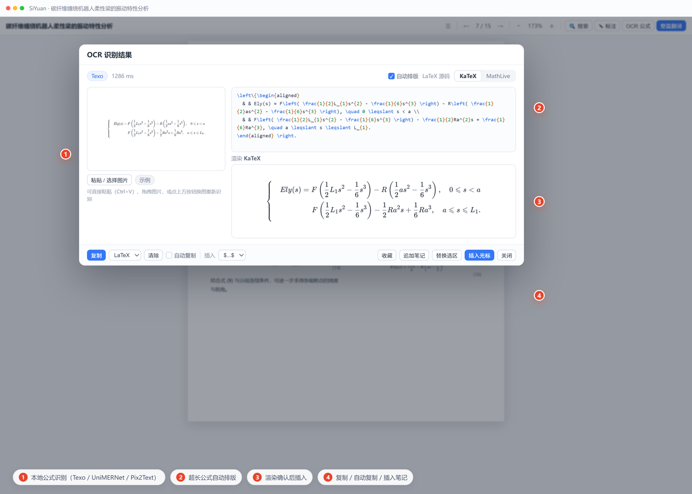

框选公式 → Texo 风格弹窗确认（源码/渲染同屏、自动排版、10 种复制格式）→ 插入笔记。
</details>

<details>
<summary><b>OCR 引擎设置</b></summary>

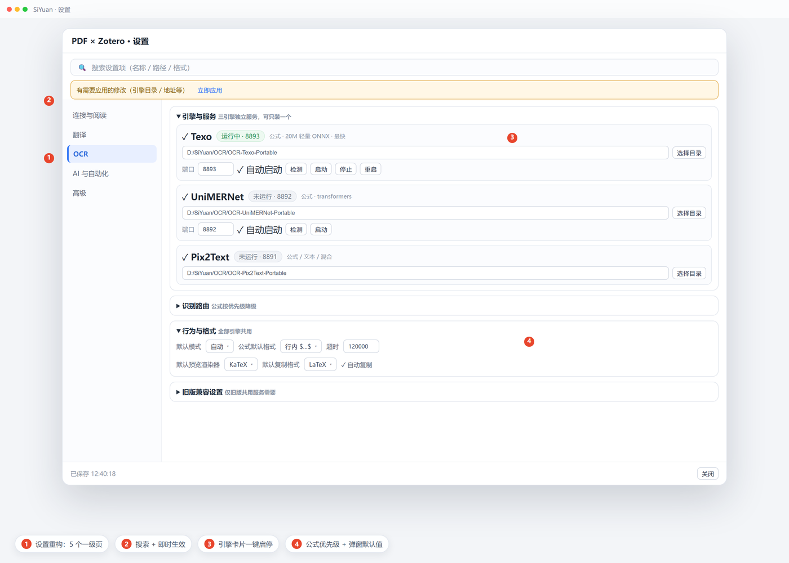

Texo / UniMERNet / Pix2Text 三引擎独立服务，可单独启停；公式优先级失败自动降级。
</details>

<details>
<summary><b>公式源码排版</b></summary>

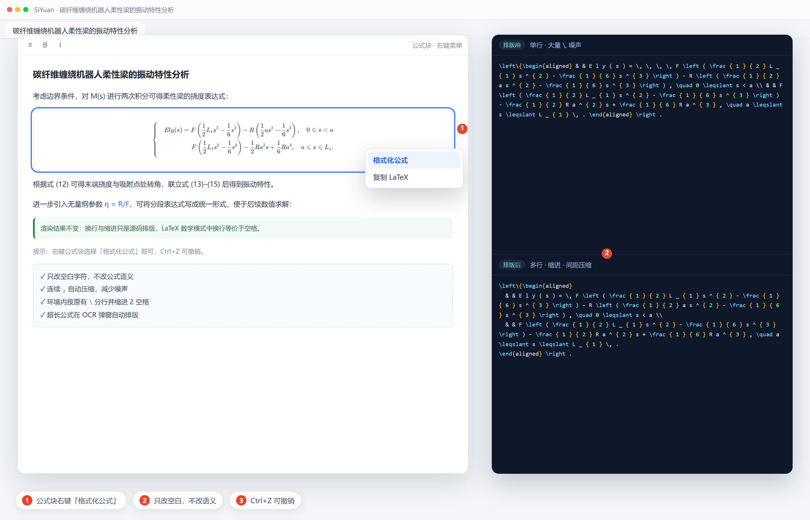

超长公式自动换行 + 缩进 + 压缩 `\,` 噪声，渲染不变；公式块右键「格式化公式」。
</details>

---

## 安装

### 1. 插件本体

1. 安装思源桌面版 **3.8.7+**；
2. `设置 → 集市 → 已下载 → 安装本地插件`，选择 `siyuan-pdf-zotero-0.9.60.zip`；
   - 压缩包已按思源插件规范打包：`plugin.json`、`index.js`、`i18n/`、`styles/` 等直接位于 zip 根目录，**没有嵌套文件夹**；
3. 启用插件，右侧栏会出现 **PDF × Zotero** Dock，顶栏出现打开 PDF 的图标。

### 2. 离线功能包（按需，可选）

| 包 | 用途 | 安装方式 |
|---|---|---|
| Texo / UniMERNet / Pix2Text | 本地 OCR | 解压到固定目录 → 插件设置 → OCR → 引擎卡片选目录、启用、点「检测」 |
| PDF2zh | 本地整篇翻译 | 解压 `SiYuan-PDF2zh-Portable.zip` → 设置 → 翻译 › 整篇 → 填服务目录 → 检测 |
| OCR-Service-Portable | 旧版共用 OCR 服务 | 仅支持 Pix2Text / UniMERNet；**Texo 必须使用 OCR-Texo-Portable** |

> 三个 OCR 引擎都自带 Python 运行时，**不需要单独装 Python**。多个引擎可在设置里共用一份运行时目录以节省磁盘。
>
> 把解压后的引擎包放在插件安装目录（或插件目录下的 `services/`）时，设置页会自动索引并填入目录；PDF2zh 同理（选整包或其中的 `pdf2zh-server` 目录均可）。也可以手动点「选择目录」。

---

## 快速开始

1. 顶栏图标或 Dock「打开本地 PDF」→ 选择 PDF；Zotero 文献可在 Dock 的 Zotero 标签页搜索后打开。
2. 选中文字 → 划词翻译（免费服务无需配置）；或点工具栏翻译按钮。
3. 选中公式/区域 → 工具栏 OCR 框选 → 识别结果弹窗确认后「插入光标」。
4. 需要整篇翻译：解压 PDF2zh 便携包并在设置里选目录，然后点 PDF 顶部「整篇翻译」。
5. 想把 PDF 引文写进笔记：选中文字 → 插入引文/摘录，笔记里会出现可回跳的结构化链接。

---

## 功能详解

### PDF 阅读与标注

- 打开本地 PDF、Zotero 附件、最近打开/继续阅读；
- PDF.js 渲染，页码跳转、上一页/下一页、缩放（适应宽度/页面/自定义）、键盘快捷键；
- 全文搜索并高亮；
- 阅读位置记忆，多 PDF 同时打开（会话恢复）；
- 文本选择 + 多色高亮 + 摘录到笔记；
- 矩形选区截图嵌入笔记（可配置截图标题模板）；
- PDF++ 风格区域链接：截图 + 区域链接，点击笔记回到 PDF 原位置；
- 悬浮预览：PDF 内链、标注卡片、思源块反链；
- 标注卡片：高亮颜色、备注、翻译、跳转；
- 可选把高亮写回源 PDF（默认关闭）；
- 复制格式可配置：链接 / 嵌入 / Callout / 引用，显示文本支持标题-页码、页码、原文、Emoji、自定义模板。

### 本地 OCR（三引擎）

| 引擎 | 能力 | 默认端口 | 包 |
|---|---|---|---|
| **Texo** | 仅公式，20M 参数 ONNX，纯 CPU，最快 | 8893 | `OCR-Texo-Portable.zip` |
| **UniMERNet** | 仅公式，transformers 推理 | 8892 | `OCR-UniMERNet-Portable.zip` |
| **Pix2Text** | 公式 + 文本 + 混合 | 8891 | `OCR-Pix2Text-Portable.zip` |

- 引擎各自独立服务、独立目录与端口；指向同一目录的引擎共用一个服务进程（兼容旧版 OCR-Service-Portable）；
- 引擎卡片：启用、目录、端口、自动启动、状态、环境检测、启动/停止/重启；
- 目录自动识别：选错包时（例如把旧版 `ocr-server` 填给 Texo）会提示并阻止保存；同目录引擎自动共用端口；点「检测」会自动拉起服务并显示失败原因与服务日志；
- 公式识别按可配置优先级（默认 Texo → UniMERNet → Pix2Text）依次尝试，失败自动降级并在弹窗显示实际引擎；
- 文本/混合引擎单独指定；
- 弹窗内可直接粘贴、拖拽、选择图片重新识别；Texo 包内置 3 张示例图片；
- 结果弹窗：LaTeX 源码编辑 + KaTeX/MathLive 渲染、自动排版、复制/自动复制（10 种格式）、插入光标、追加笔记、替换选区、复制 Markdown、收藏；
- 超长公式排版：安全换行/缩进、连续 `\,` 压缩，渲染不变；公式块右键「格式化公式」；
- OCR 历史与收藏（Dock 入口）；
- 快捷键：ESC 关闭弹窗时同时收起 MathLive 虚拟键盘；截图/框选模式 ESC 退出。

### 翻译

**划词翻译**
- 免费服务：Bing Translator、MyMemory（无需 API Key）；
- 第三方服务：思源内置 AI、OpenAI 兼容接口、DeepL、Google、百度、有道、腾讯云、阿里云、Azure、彩云小译；
- 目标语言可跟随全局默认，也可单独覆盖；
- 选中自动翻译开关、最短字符、显示原文；
- 译文弹窗支持复制、写入标注、原文回跳；ESC/点击空白关闭。

**整篇 PDF 翻译**
- PDF2zh 本地服务（双语对照 / 纯译文，左右/上下对照，源语言可选）；
- Doc2X 个人账号：模型下拉实时读取 `doc2x models list`（仅当前账号可用模型）；输出可选纯译文 / 对照翻译，对照翻译再选固定排版双栏 PDF 或文档型 Markdown；支持术语表、字体策略、忽略表格/代码/图片/文献、上下文增强、保留原字色；
- Doc2X PDF→Markdown：解析模型（doc2x / mathpix 图片模型 + 官方视觉模型）与翻译模型都可配置；解析结果保存到解析库，插入前可预览并选择清洗项；
- Doc2X 解析结果管理：Dock「解析翻译」列表可筛选解析/翻译结果，右键可预览、插入、新建文档、翻译、定位原 PDF、删除；
- 解析结果翻译：右键「翻译…」弹窗可选 Doc2X 保版翻译（重新解析，提示消耗页数）或快速翻译已有 Markdown（不消耗额度，公式/表格保持原文，支持仅译文/双语）；
- 解析样式清洗：公式统一转 `$...$` / `$$...$$`、HTML 表格转 Markdown、移除 Doc2X 包装标签，插入前可逐项开关；
- 译文输出目录、译文历史、打开译文/原文/所在目录、删除/清空记录；
- 翻译期间进度 HUD 显示进度与日志，**ESC 可退出等待**。

### Zotero 与引文

- Zotero 7+ Local API，只读访问；
- 标题/作者/DOI 搜索、Collection 过滤、分页、置顶；
- 一键用模板从 Zotero 条目创建笔记；
- 内置 121 种 CSL 样式，GB/T 7714、APA、IEEE 等；
- 引文对话框搜索样式并插入，文内引文编号按顺序自动刷新；
- 参考文献块自动补齐与恢复。

### 文献矩阵

- 一个研究项目一个矩阵；
- 8 个系统列 + 12 个研究字段；
- Zotero Collection 批量导入；
- 行内编辑、筛选、排序、分组、保存视图；
- 批量编辑、行详情；
- AI 填充预览后应用；
- 导出 CSV / 导出为思源表格。

### 默认笔记模板

- Better Notes 风格 `${...}`、`${{...}}$` 表达式与代码块；
- `topItem` / `Zotero.Items` 兼容层；
- 内置模板 + 模板管理器 + 导入 `.json/.html/.md/.txt`；
- 目标笔记本与目录、标题 pattern（`{{year}}-{{firstAuthor}}-{{shortTitle}}`）；
- 安全刷新：只更新未编辑的模板块，保留用户编辑；
- 模板执行受信任本地 JS，请只使用可信模板。

### PDF 问答

- PDF 侧边问答面板，按 PDF/文档保存会话线程；
- 默认携带选区或当前页及前后文，可切换「问全文」；
- 知识范围可选「PDF 优先 + 通用知识」或「仅依据 PDF」；
- 支持附件、来源页码链接、历史保留天数、每 PDF 会话数限制；
- 一键把 Q/A 插入笔记为自定义样式的块（颜色/字号/字体/圆角可调，带实时预览）。

### 笔记本 AI 自动化（后台）

- 监听目标笔记本新文档，自动生成摘要并维护索引表；
- 可选首次回填已有文章；
- 模型可留空跟随思源当前 AI；
- 摘要字数上限、调试日志。

### 设置（0.9.58 重构）

- 5 个一级页：**连接与阅读 / 翻译 / OCR / AI 与自动化 / 高级**；翻译页内分「选区 / 整篇 / 服务」子 tab，OCR 页内分「引擎与服务 / 识别路由 / 行为与格式」折叠块；
- 顶部**全局搜索**：搜到设置项直接跳页并高亮；
- **即时生效**：简单项改完自动保存；引擎目录、PDF2zh 地址、Doc2X CLI 等重启类修改顶部出现提示条，点「立即应用」统一生效；
- 翻译目标语言：一处默认 + 各引擎可跟随/覆盖；
- 旧版兼容设置集中到「高级」折叠区；
- OCR 历史入口移到 Dock。

---

## 从 v0.9.56 以来的主要变化

> 完整清单见 [CHANGELOG.md](CHANGELOG.md)，发布说明见 [release-notes/v0.9.60.md](release-notes/v0.9.60.md)。

- OCR 从单服务升级为 **Pix2Text / UniMERNet / Texo 三引擎独立服务**，新增 Texo 与 UniMERNet/Pix2Text 独立便携包；
- OCR 结果弹窗重做为 Texo 风格（源码/渲染同屏、KaTeX/MathLive 切换、10 种复制格式、自动复制、换图重识别、示例图）；
- 新增**超长公式自动排版**与公式块右键「格式化公式」；
- 设置对话框重构：5 页结构、全局搜索、即时生效、翻译服务内嵌管理、旧兼容折叠；
- 翻译目标语言统一为「默认 + 覆盖」；
- 修复：OCR 弹窗布局跳动/双窗格、隐藏遮罩失效、ESC 不关 MathLive 键盘、整篇翻译无法取消、OCR 换图重识别走错引擎、文本结果误当公式等；
- 新增：ESC 退出截图/框选、ESC 取消整篇翻译、剪贴板图片优先换图、文本结果独立处理。

---

## 已知限制

- 大型多行公式（`aligned` / `cases`）仍可能识别错误，需人工校对；排版只改空白不改语义，不能修复识别本身；
- Texo 只识别公式；表格/整页文字请用 Pix2Text；
- 首次启动：Texo 1–3 秒；Pix2Text 约 1–3 分钟；UniMERNet 首次推理约 2 分钟（之后常驻，单张 1–3 秒）；
- 旧 `OCR-Service-Portable` 中的 UniMERNet 受原模型包限制，建议使用独立包；
- Ethereal Style 字段未完整实现；
- PDF2zh 依赖网络翻译服务（默认 Bing）；
- 模板执行本地 JS，只使用可信模板；
- 写回 PDF 标注会修改源文件，默认关闭。

---

## 项目结构

```text
src/
  index.ts              插件入口、命令、Dock、自动化
  ui/reader.ts          PDF 阅读器、标注、OCR、翻译、问答
  ui/dock.ts            Dock、设置入口
  ui/settings-dialog.ts 设置对话框（5 页 + 搜索 + 即时生效）
  ui/ocr-dialog.ts      OCR 结果弹窗（Texo 风格 + 自动排版）
  ui/formula-format.ts  公式块右键「格式化公式」
  ocr/                  OCR 客户端、引擎注册表、多服务、LaTeX→Typst、LaTeX 排版
  matrix/               文献矩阵
  template/             笔记模板引擎
  translation/          翻译服务、PDF2zh、Doc2X、目标语言
  pdf/                  PDF.js 封装
release/                便携包目录与 zip
scripts/                构建、测试、运行时裁剪、模型转换
tests/                  Node 单元/DOM 测试
```

## 构建与测试

```powershell
node node_modules\typescript\bin\tsc --noEmit
node scripts\build-tests.mjs
node tests\run-all.mjs

node scripts\build.mjs
node scripts\install-plugin.mjs --workspace "C:\Users\Asus\SiYuan\Dataset"
```

当前验证结果：

```text
TypeScript：0 errors
Node tests：136 个（1 个跳过）
插件版本：0.9.60
```

## 安全边界

- 不修改原始 PDF（除用户显式开启「写回标注」）；
- 不修改 `.sy` 文件格式；
- 不打开或写入 `zotero.sqlite`，只读 Zotero Local API；
- 只使用思源公开 API；
- OCR / 翻译服务只在本机运行，不上传文件到第三方（除非你主动选择第三方翻译/翻译提供方）。

## 版本与发布

- 统一发布页：https://github.com/DJYDN/siyuan-pdf-zotero/releases/tag/v0.9.60
- 版本说明：[`RELEASE_TAGS.md`](RELEASE_TAGS.md)
- 变更日志：[`CHANGELOG.md`](CHANGELOG.md)

## 致谢

- [SiYuan](https://b3log.org/siyuan/)
- [PDF.js](https://mozilla.github.io/pdf.js/)
- [Pix2Text](https://github.com/breezedeus/Pix2Text)
- [UniMERNet](https://github.com/opendatalab/UniMERNet)
- [Texo](https://github.com/alephpi/Texo)（AGPL-3.0，独立引擎包分发）
- [PDFMathTranslate](https://github.com/Byaidu/PDFMathTranslate)
- [citeproc-js](https://github.com/Juris-M/citeproc-js)
- [MathLive](https://mathlive.io/)
