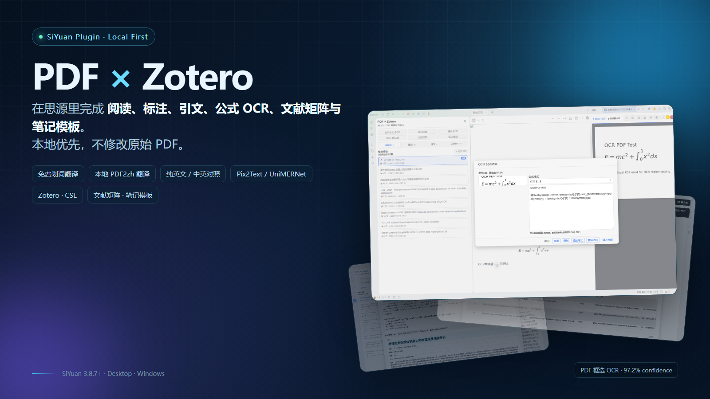

# SiYuan PDF × Zotero



[](https://b3log.org/siyuan/)
[](https://www.typescriptlang.org/)
[](LICENSE)

在思源笔记里完成 **PDF 阅读、PDF++ 风格标注、免费划词翻译、本地整篇 PDF 翻译、Zotero 引文、公式 OCR、文献矩阵和默认笔记模板**。

本地优先，不修改原始 PDF，不写入 Zotero 数据库。

当前版本：**0.9.56**

> **翻译亮点**：划词翻译免费（Bing / MyMemory）；整篇 PDF 可在本地跑 PDF2zh；支持纯英文输出、中英文对照、译文历史和第三方翻译服务。

---

## 下载

| 包 | 用途 |
|---|---|
| `siyuan-pdf-zotero-0.9.56.zip` | 思源插件本体 · SHA-256 `E6C081C653E1C0C9C5BEABE472B37A8676A55D0A6FD2FA4231905DCDB7474D7F` |
| `SiYuan-PDF2zh-Portable.zip` | PDF2zh 整篇翻译便携包 · SHA-256 `66AB82F8885796153EEC56CF81D536E43ADA5F1E27D3450D90838CBBC4C8D27E` |
| `OCR-Service-Portable.zip` | 本地 OCR 便携包（Pix2Text + UniMERNet 适配） · SHA-256 `022DEDE663633C7556B19C04D1EE02873A83352B26AEB96A743C8A9C848BCFE7` |

每个包目录内都有独立 `README.md` 和 `SHA-256` 文件。

## GitHub Release

统一发布页（一次 Release，三个附件）：

https://github.com/DJYDN/siyuan-pdf-zotero/releases/tag/v0.9.56

发布页内包含：

```text
siyuan-pdf-zotero-0.9.56.zip
SiYuan-PDF2zh-Portable.zip
OCR-Service-Portable.zip
```

---

## 核心功能

### PDF 阅读与标注

- 在思源中打开本地 PDF 或 Zotero PDF；
- PDF.js 渲染、目录、页码、前进/后退、缩放；
- 全文搜索、阅读位置记忆、多 PDF 会话；
- 文本选择、高亮、摘录；
- 矩形选区截图并插入笔记；
- PDF++ 风格区域链接：插入截图并复制区域链接；
- 点击笔记回到 PDF 原位；
- 悬浮预览：PDF 内链、标注卡片、反链。

### 翻译：免费划词 + 本地整篇 + 第三方

- **免费划词翻译**：内置 Bing Translator、MyMemory，无需 API Key；
- **本地整篇 PDF 翻译**：PDF2zh 本地便携包，不修改原 PDF；
- **纯英文输出**：PDF2zh 单语模式、Doc2X 纯译文 PDF；
- **中英文对照输出**：PDF2zh 双语对照、Doc2X 双语排版 PDF；
- **译文管理**：Dock 译文历史、打开译文/原文、打开输出目录、删除记录、清空记录；
- **第三方翻译服务**：思源内置 AI、OpenAI 兼容、DeepL、Google、Bing、MyMemory、百度、有道、腾讯云、阿里云、Azure、彩云小译；
- 划词翻译弹窗支持复制译文、写入标注、附带原文回跳；
- 整篇翻译可配置输出目录、源语言、目标语言、单语/双语模式。

### Zotero 与引文

- Zotero 7+ Local API；
- 标题/作者/DOI 搜索、Collection 过滤；
- 结构化引文链接；
- 内置 121 种 CSL 样式；
- GB/T 7714、APA、IEEE 等引文与参考文献；
- 引文编号按文档顺序刷新。

### 本地 OCR

- Pix2Text 公式/文本/混合识别；
- UniMERNet 公式识别适配；
- PDF 框选 OCR、剪贴板 OCR；
- OCR 预览、编辑、公式格式切换；
- 插入光标、复制、追加笔记、替换选区；
- OCR 历史、收藏；
- Pix2Text 高级选项：设备、超时、MFD/MFR 模型、静态尺寸、上下文、拼写检查、表格识别；
- UniMERNet 目录、配置文件和设备配置。

### 文献矩阵

- 一个研究项目一个矩阵；
- 8 个系统列 + 12 个研究字段；
- Zotero Collection 批量导入；
- 行内编辑、筛选、排序、分组；
- 保存视图、重命名、删除；
- 批量编辑；
- 行详情面板；
- AI 填充：预览后应用；
- 导出 CSV、导出 SiYuan 表格快照。

### 默认笔记模板

- Better Notes 风格 `${...}` 与 `${{...}}$`；
- `topItem` / `Zotero.Items` 兼容层；
- 两个内置模板；
- 模板管理器、导入 `.json/.html/.md/.txt`；
- 目标笔记本选择；
- 标题格式；
- 模板笔记创建、映射；
- 安全刷新：只更新未编辑的模板块，保留用户编辑。

---

## 安装插件

1. 安装思源桌面版 3.8.7+；
2. 设置 → 集市 → 已下载 → 安装本地插件；
3. 选择 `siyuan-pdf-zotero-0.9.56.zip`；
4. 右侧栏启用 **PDF × Zotero** Dock。

## OCR 安装

1. 解压 `OCR-Service-Portable.zip` 到固定位置；
2. 插件设置 → OCR：
   - 服务目录：解压目录；
   - 引擎：Pix2Text 或 UniMERNet；
   - UniMERNet 目录：选择 UniMERNet 解压目录；
   - 检测 OCR 环境；
3. 公式识别建议使用公式模式；
4. 大型多行公式建议缩小框选范围；UniMERNet 需要单独模型包。

## PDF2zh 安装

1. 解压 `SiYuan-PDF2zh-Portable.zip`；
2. 安装其中的 `plugin/siyuan-pdf-zotero-0.9.56.zip`；
3. 设置 → PDF2zh：
   - 地址：`http://127.0.0.1:8890`
   - 服务目录：`...\pdf2zh-server`
4. 打开 PDF，点击整篇翻译。

---

## 项目结构

```text
src/
  index.ts            插件入口、命令、Dock
  ui/reader.ts        PDF 阅读器、标注、OCR、翻译
  ui/dock.ts          Dock 与设置
  ocr/                OCR 客户端、服务、历史
  matrix/             矩阵模型
  template/           模板引擎、笔记创建
  translation/        翻译服务
  pdf/                PDF.js 封装
ocr-server/
  pz_ocr_server.py    本地 OCR HTTP 服务
  README-UNIMERNET.md UniMERNet 接入说明
scripts/              构建、测试、打包
tests/                Node 单元/集成测试
```

## 构建与测试

```powershell
node node_modules\typescript\bin\tsc --noEmit
node scripts\build-tests.mjs
node tests\run-all.mjs

node scripts\build.mjs
node scripts\install-plugin.mjs --workspace "C:\Users\Asus\SiYuan\Dataset"
```

当前验证结果：

```text
TypeScript：0 errors
Node tests：35/35 pass
插件版本：0.9.56
```

## 安全边界

- 不修改原始 PDF；
- 不修改 `.sy` 文件；
- 不打开或写入 `zotero.sqlite`；
- 只使用思源公开 API 和 Zotero Local API；
- OCR/翻译服务只在本机运行。

## 已知限制

- 大型多行公式（`aligned` / `cases`）仍可能出现识别错误，需要人工校对；
- UniMERNet 真实模型包尚未完成端到端验收；
- Ethereal Style 完整字段尚未实现；
- 模板直接执行受信任的本地 JS，请只使用可信模板；
- PDF2zh 依赖网络翻译服务。

## 版本与发布

- 最新版本：`0.9.56`
- 发布标签说明见 [`RELEASE_TAGS.md`](RELEASE_TAGS.md)
- 详细变更见 [`CHANGELOG.md`](CHANGELOG.md)

## 致谢

- [SiYuan](https://b3log.org/siyuan/)
- [PDF.js](https://mozilla.github.io/pdf.js/)
- [Pix2Text](https://github.com/breezedeus/Pix2Text)
- [UniMERNet](https://github.com/opendatalab/UniMERNet)
- [PDFMathTranslate](https://github.com/Byaidu/PDFMathTranslate)
- [citeproc-js](https://github.com/Juris-M/citeproc-js)
